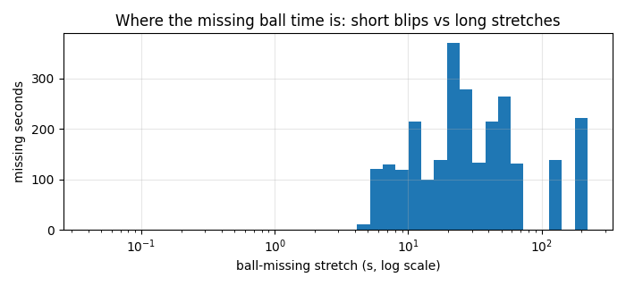
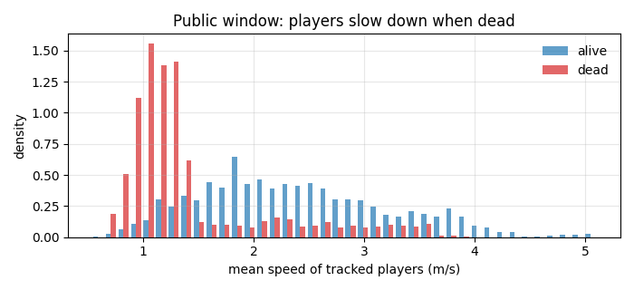
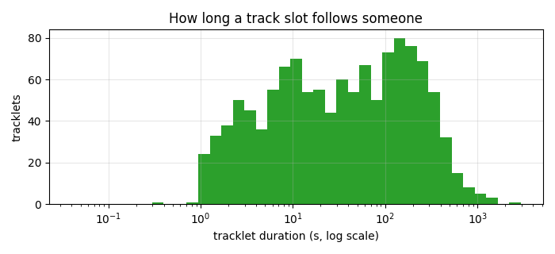

# EDA: BAR-ATH tactical tracking

Generated by `python -m saha.tools.eda` on 2026-10-31 from the data bundle with ATD sha256 f130e350d2bf… (raw) / 327e35e32e46… (metadata). Aggregates only: no frame-level data. Do not edit by hand; re-run the tool.

## Coverage

| | all frames | graded | 1st half | 2nd half |
|---|---|---|---|---|
| ball visible | 56.9% | 59.3% | 59.3% | 59.3% |
| tracked slots per frame (mean) | 19.0 | 20.5 | 20.1 | 20.9 |

On graded frames: home 10.2 and away 10.3 tracked slots on average. 2.4% of frames have more than 22 tracked (duplicates) and 9.2% have fewer than 18.

## Ball-missing stretches (graded frames)

150 stretches. Durations in seconds: p50 10.72, p75 21.06, p90 33.81, p99 104.75, max 221.48.

| stretch length | stretches | share of missing frames |
|---|---|---|
| 0–0.2 s | 13 | 0.0% |
| 0.2–1 s | 4 | 0.1% |
| 1–3 s | 0 | 0.0% |
| 3–10 s | 54 | 14.6% |
| ≥ 10 s | 79 | 85.2% |

## Ball outside the pitch lines

Of graded frames with a visible ball, 4.19% place it outside the 0–1 pitch and 2.12% within 1 m inside a line. Ranges seen: x -0.065..1.062, y -0.107..1.338.

81 excursions outside; durations (s): p50 0.84, p75 3.32, p90 4.88, p99 12.50, max 13.88.

## Player speed when the ball is dead

Per-frame mean speed of tracked players (m/s), public window split by the public ground truth:

| | frames | median | p10 | p90 | ball visible |
|---|---|---|---|---|---|
| dead (D) | 1469 | 1.19 | 0.90 | 2.59 | 66.4% |
| alive (H/A) | 6031 | 2.27 | 1.33 | 3.65 | 93.5% |

Whole match, graded frames: p10 0.71, p50 1.52, p90 3.12, max 6.32.

## Smart Tagging restarts against the public ground truth

Restart tags in the whole match: 26 Throw-in, 12 Corner Kick, 10 Goal Kick, 5 Free Kick, 4 Kick Off (After Goal), 2 Kick Off (Start).

3 restart tags overlap the public window, which has 4 D→H/A restarts. For each tag, the nearest restart in the ground truth lies (frames, + = after):

| | median | min | max |
|---|---|---|---|
| after the tag's start | 305 | 69 | 1892 |
| after the tag's end | -570 | -806 | 1767 |

Team tag agrees with the restarting team in 2 of 2 tags with a team (1 are N/A).

## Track slots: fragmentation and identity switches

43 of 46 slots are used on graded frames. They form 1219 tracklets (unbroken presence) of duration (s): p50 35.52, p75 145.32, p90 284.63, p99 774.42, max 2937.08.

11.5 tracklets start per graded minute. Jumps of more than 1 m between consecutive frames inside a tracklet (a proxy for an identity switch): 300 in total, 2.83 per graded minute.

