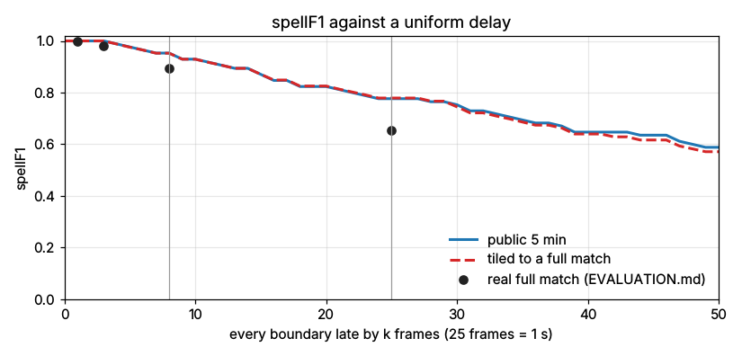

# How spellF1 reacts to mistakes

Generated by `python -m saha.tools.metric_behaviour` from the official scorer (`evaluation/possession_metrics.py`, unmodified). Do not edit by hand: change the tool and re-run it.

This is a study of the **metric**, not of a model. Use it to reason about which mistakes to avoid. Never use the public window to choose between two versions of the pipeline (CLAUDE.md).

## What the scorer does, in seven lines

1. Only frames where the ground truth is not X are graded. That means the two halves 11185–90651 and 110808–190197; on the public file it means 11185–18684 only.
2. Your X labels are forward-filled with your last label in the same half (back-filled at the head). spellF1 never sees an X. macroF1 counts every X on a graded frame as a miss.
3. A possession is a maximal run of H or of A. D separates possessions: `H D H` is two possessions.
4. Predicted and true possessions of the **same team** are paired by temporal IoU. The pairing is greedy, highest IoU first, and one-to-one.
5. F1 = 2TP / (2TP + FP + FN) at IoU 0.3, 0.4, 0.5, 0.6 and 0.7. spellF1 is the mean of the five.
6. Every possession counts once. A 1-second possession weighs as much as a 40-second one.
7. `validate_submission.py` counts possessions with each X as a gap. The scorer bridges X, so its count can be lower.

## References used below

| reference | possessions | mean duration |
|---|---|---|
| public (the 5 minutes as published) | 17 | 14.2 s |
| tiled (public pattern repeated over both halves) | 362 | 14.3 s |

The public window has possessions of 0.8 s and 1.3 s. The real match will have many short ones too. The tiled reference only rescales the counts; its possession count is an extrapolation, not the real match's (which is not published).

Random mistakes (jitter, picked possessions) are averaged over 50 seeds on public and 20 on tiled. **Δ/mistake** is the tiled loss divided by the number of mistakes: read it as the full-match price of one more such mistake.

## Timing: late, early and noisy boundaries

| mistake | public spellF1 | public macroF1 | tiled spellF1 | Δ/mistake (tiled) | tiled possessions |
|---|---|---|---|---|---|
| everything 1 frame late | 1.0000 | 0.9973 | 1.0000 |  | 362 vs 362 |
| 3 frames late | 1.0000 | 0.9918 | 1.0000 |  | 362 vs 362 |
| 8 frames late | 0.9529 | 0.9782 | 0.9525 |  | 362 vs 362 |
| 12 frames (0.5 s) late | 0.9059 | 0.9672 | 0.9061 |  | 362 vs 362 |
| 1 s late | 0.7765 | 0.9331 | 0.7790 |  | 362 vs 362 |
| 2 s late | 0.5882 | 0.8745 | 0.5713 |  | 362 vs 362 |
| every boundary moved by a random -5..+5 frames | 0.9955 | 0.9925 | 0.9957 |  | 362 vs 362 |
| random -12..+12 frames | 0.9605 | 0.9829 | 0.9609 |  | 362 vs 362 |
| random -25..+25 frames | 0.8906 | 0.9655 | 0.8923 |  | 362 vs 362 |
| only H<->A hand-overs 12 frames late | 0.9059 | 0.9837 | 0.9061 |  | 362 vs 362 |
| only hand-overs 1 s late | 0.8235 | 0.9669 | 0.8232 |  | 362 vs 362 |
| both ends of every stoppage 12 frames late | 1.0000 | 0.9835 | 1.0000 |  | 362 vs 362 |
| both ends of every stoppage 2 s late | 0.9529 | 0.9313 | 0.9558 |  | 362 vs 362 |

## False splits: one possession reported as several

| mistake | public spellF1 | public macroF1 | tiled spellF1 | Δ/mistake (tiled) | tiled possessions |
|---|---|---|---|---|---|
| 1 possession split by a 5-frame fake possession | 0.9104 | 0.9994 | 0.9956 | -0.0044 | 364 vs 362 |
| 1 split by a 1 s fake possession | 0.9089 | 0.9972 | 0.9954 | -0.0046 | 364 vs 362 |
| 5 splits by 1 s fake possessions | 0.6255 | 0.9859 | 0.9775 | -0.0045 | 372 vs 362 |
| 1 possession split by a 1 s fake stoppage | 0.9349 | 0.9957 | 0.9968 | -0.0032 | 363 vs 362 |
| 5 splits by 1 s fake stoppages | 0.7056 | 0.9790 | 0.9842 | -0.0032 | 367 vs 362 |

## Merges: possessions or stoppages missed

| mistake | public spellF1 | public macroF1 | tiled spellF1 | Δ/mistake (tiled) | tiled possessions |
|---|---|---|---|---|---|
| 1 hand-over missed (A H A -> A A A) | 0.9178 | 0.9721 | 0.9962 | -0.0038 | 360 vs 362 |
| 5 hand-overs missed | 0.6040 | 0.8117 | 0.9813 | -0.0037 | 353 vs 362 |
| every possession < 1 s missed | 0.9125 | 0.9979 | 0.9106 |  | 318 vs 362 |
| every possession < 2 s missed | 0.8267 | 0.9941 | 0.8300 |  | 278 vs 362 |
| every possession < 4 s missed | 0.5600 | 0.9671 | 0.5594 |  | 170 vs 362 |
| 1 stoppage missed (split between neighbours) | 0.9539 | 0.9344 | 0.9978 | -0.0022 | 362 vs 362 |

## Wrong team

| mistake | public spellF1 | public macroF1 | tiled spellF1 | Δ/mistake (tiled) | tiled possessions |
|---|---|---|---|---|---|
| 1 possession given to the wrong team | 0.9255 | 0.9700 | 0.9959 | -0.0041 | 360 vs 362 |
| 5 possessions given to the wrong team | 0.5851 | 0.7920 | 0.9816 | -0.0037 | 355 vs 362 |

## Abstaining with X

| mistake | public spellF1 | public macroF1 | tiled spellF1 | Δ/mistake (tiled) | tiled possessions |
|---|---|---|---|---|---|
| X for 2 s mid-possession, everywhere | 1.0000 | 0.9669 | 1.0000 |  | 362 vs 362 |
| X for 0.5 s after every hand-over | 0.9059 | 0.9918 | 0.9061 |  | 362 vs 362 |
| X for 1 s after every hand-over | 0.8235 | 0.9830 | 0.8232 |  | 362 vs 362 |

## How late can a boundary be?

A possession of L frames delayed by k frames keeps IoU (L − k)/(L + k). It still matches at threshold τ while k ≤ L(1 − τ)/(1 + τ). That gives these frame budgets:

| possession | τ=0.3 | τ=0.4 | τ=0.5 | τ=0.6 | τ=0.7 |
|---|---|---|---|---|---|
| 1 s | 13 | 10 | 8 | 6 | 4 |
| 2 s | 26 | 21 | 16 | 12 | 8 |
| 4 s | 53 | 42 | 33 | 25 | 17 |
| 8 s | 107 | 85 | 66 | 50 | 35 |
| 15 s | 201 | 160 | 125 | 93 | 66 |
| 30 s | 403 | 321 | 250 | 187 | 132 |

Short possessions decide the score. A 1 s possession must be within 4 frames to count at τ=0.7, and a 2 s one within 8.

## The real match is more sensitive than these references

EVALUATION.md publishes the same 'everything late' test scored on the **full match**. It loses more than either of our references:

| everything late by | full match (EVALUATION.md) | public | tiled |
|---|---|---|---|
| 1 frames | 1.0000 | 1.0000 | 1.0000 |
| 3 frames | 0.9818 | 1.0000 | 1.0000 |
| 8 frames | 0.8933 | 0.9529 | 0.9525 |
| 25 frames | 0.6539 | 0.7765 | 0.7790 |

So the full match is more sensitive to boundary timing than the public window. The likely cause is that it has proportionally more very short possessions. Treat every number on this page as **optimistic**: boundary precision is worth more than it looks here.

Do not reverse-engineer private ground-truth statistics (possession count, duration distribution) from published numbers like these and tune against them. The organisers withhold those statistics on purpose (OVERVIEW.md), and the team rule is the same (CLAUDE.md).

## Rules of thumb for the team

Each price below is measured on the tiled reference (362 possessions). It is given both as spellF1 and as the number of possessions lost (Δ × possessions). Re-run the tool if the scorer changes.

- **Every mistake costs about one to two possessions.**
    - Inventing a short opposite-team possession inside a real one: -0.0046 (≈ 1.7 possessions).
    - Missing a hand-over (`A H A → A A A`): -0.0038 (≈ 1.4 possessions).
    - Giving a possession to the wrong team: -0.0041 (≈ 1.5 possessions).
    - Inventing a stoppage inside a possession: -0.0032 (≈ 1.2 possessions).
    - Missing a stoppage: -0.0022 (≈ 0.8 possessions).
  When the evidence for a short possession is a coin flip, reporting it and missing it cost about the same. Decide on the evidence, not on a rule of thumb.
- **Short possessions are where the score is.** Losing every possession under 2 s costs 0.170 on the tiled reference, and more on the real match (see above). A model that never reports short possessions caps itself.
- **Boundary error is graded per possession.** 8 frames is invisible on a 30 s possession. It pushes a 2 s possession out of the τ=0.7 match. A uniform 8-frame delay costs 0.048 here and 0.107 on the real match.
- **X in mid-possession is free for spellF1.** It still costs macroF1, the first tie-break: 2 s of X in every possession drops public macroF1 to 0.967.
- **X after a hand-over costs exactly as much as being late.** The fill carries the old team forward. Abstain only where the team is not about to change.
- **Do not trust small gaps.** On the public window one possession is about 1/17 of the score. On the full match, gaps below ~0.04 are noise (EVALUATION.md). Run `--bootstrap 1000` before believing any difference.
